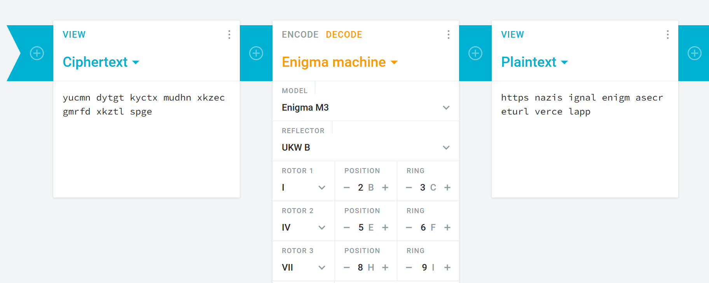
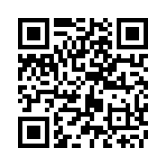

# Sinyal Rahasia 1944

---

#### **📋** Challenge Description

- **Category : Misc**
- **Difficulty : Easy**
- **Hint : 🥨**

"Pesan radio yang disadap dari tahun 1944 ini adalah transmisi terakhir dari Unit U-Boat musuh. Teks dienkripsi dengan metode kompleks yang membutuhkan konfigurasi harian yang tepat.

Bersamaan dengan pesan sandi, kami hanya menemukan sebuah notasi aneh berupa matriks angka. Tugas Anda: Interpretasikan matriks tersebut untuk menemukan pengaturan yang diperlukan, dekripsi Ciphertext yang tersisa, dan temukan Alamat Tujuan yang diungkapkan oleh pesan tersebut."

```html
yucmn dytgt kyctx mudhn xkzec gmrfd xkztl spge

1 2 3
4 5 6
7 8 9
```

---

**Step 1 : Decode The Cipher Text**

Dari deskripsi dan hint chall yaitu **kue pretzel** dan **kapal U-Boat,** sama-sama berasal dari negara Jerman, jadi dapat disimpulkan bahwa cipher text yang diberikan adalah cipher yang berasal dari negara Jerman yaitu `enigma cipher` .



Di sini saya coba decode ciphertext nya di web cryptii, lalu posisi rotornya ubah sesuai posisi angka yang ada di deskripsi chall, setelah kita decode kita pun akan mendapatkan sebuah url.

[https://nazisignalenigmasecreturl.vercel.app/](https://nazisignalenigmasecreturl.vercel.app/)

---

**Step 2 : Identifikasi Web**

Langsung saja visit web tersebut.


Kita coba source code dari web ini


Terdapat string aneh yang sudah diencode ke base64, yang jika kita decode akan menghasilkan pesan **`“ada di header”` ,** jadi dapat kita simpulkan ada sesuatu yang tersembunyi di header request web ini.

Di sini kita bisa menggunakan panel network dari devtools untuk melihat request yang ada pada web ini.


Terdapat file png di request web ini, langsung saja kita download file png tersebut.



Ternyata file png tersebut adalah sebuah kode QR yang jika kita decode maka kita akan mendapatkan flag.

**`FGTE{n4z1_51gn4l_h7t7p5_53cr377_7ur1}`**
